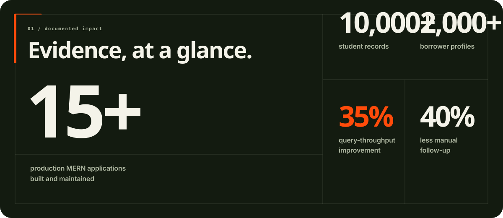

  

I build product interfaces, backend systems, and applied AI tools. Most of my work sits where those layers meet: clear service boundaries, secure APIs, deliberate data flows, and software a team can operate without guesswork.

  

Impact figures are drawn from my resume and describe work completed in documented engineering roles.

  

  
<strong>Searchable technology index</strong>

- **Product interfaces:** React, Next.js, TypeScript, Redux Toolkit, TanStack Query, Tailwind CSS, shadcn/ui
- **APIs and real-time systems:** Node.js, Express, REST, GraphQL, Socket.IO, Server-Sent Events, BullMQ, Redis Pub/Sub
- **Data systems:** MongoDB, PostgreSQL, MySQL, Prisma, Redis
- **Applied AI:** Vercel AI SDK, OpenRouter, Ollama, Google Gemini, Mastra AI, Model Context Protocol, tool calling
- **Security controls:** JWT, OAuth 2.0, RBAC, Passport.js, bcrypt, HMAC-SHA256 validation, input sanitization
- **Infrastructure:** AWS, Docker, Kubernetes, Nginx, PM2, GitHub CI/CD, Vercel

  
  

The heatmap is rendered from GitHub’s public contribution data by a third-party service and may be temporarily unavailable if that service is down.

  

  

  [GitHub](https://github.com/Mr-Elegant) · [LinkedIn](https://www.linkedin.com/in/preetkarwal/) · [Portfolio](https://preetportfol.vercel.app/) · [Email](mailto:preetverma365@gmail.com)

