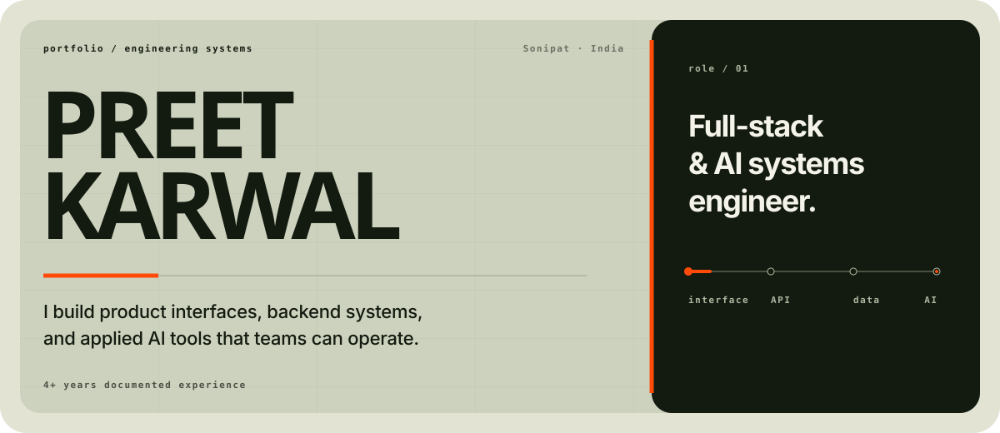

  

I build product interfaces, backend systems, and applied AI tools. Most of my work sits where those layers meet: clear service boundaries, secure APIs, deliberate data flows, and software a team can run without guesswork.

Based in **Sonipat, Haryana**, with **4+ years of documented software engineering experience**.

## Work in numbers

- Built and maintained **15+ production MERN applications**.
- Architected a university ERP supporting **10,000+ student records**, with BullMQ and Redis handling background work.
- Delivered a loan origination and management system serving **2,000+ borrower profiles**.
- Improved documented MongoDB query throughput by **35%** through aggregation-pipeline optimization.
- Reduced documented manual follow-up by **40%** by connecting CRM, accounting, and WhatsApp workflows.

## Working set

**Product interfaces**  
React · Next.js · TypeScript · Redux Toolkit · TanStack Query · Tailwind CSS · shadcn/ui

**APIs and real-time systems**  
Node.js · Express · REST · GraphQL · Socket.IO · Server-Sent Events · BullMQ · Redis Pub/Sub

**Applied AI**  
Vercel AI SDK · OpenRouter · Ollama · Google Gemini · Mastra AI · Model Context Protocol · tool calling

**Data and infrastructure**  
MongoDB · PostgreSQL · MySQL · Prisma · Redis · AWS · Docker · Kubernetes · Nginx · PM2 · Vercel

**Security and quality**  
JWT · OAuth 2.0 · RBAC · Passport.js · bcrypt · HMAC-SHA256 validation · Jest · integration testing

## Background

- **MCA**, Maharshi Dayanand University, Rohtak — 2018–2021
- **BCA**, Maharshi Dayanand University, Rohtak — 2016–2018
- **Networking Fundamentals & Ethical Hacking**, Hi-Tech Institute, New Delhi — listed on my resume; no public credential URL supplied

## Contribution history

  

Rendered from GitHub’s public contribution data by a third-party service; it may be temporarily unavailable if that service is down.

## Find me

[GitHub](https://github.com/Mr-Elegant) · [LinkedIn](https://www.linkedin.com/in/preetkarwal/) · [Portfolio](https://preetportfol.vercel.app/) · [Email](mailto:preetverma365@gmail.com)

  

